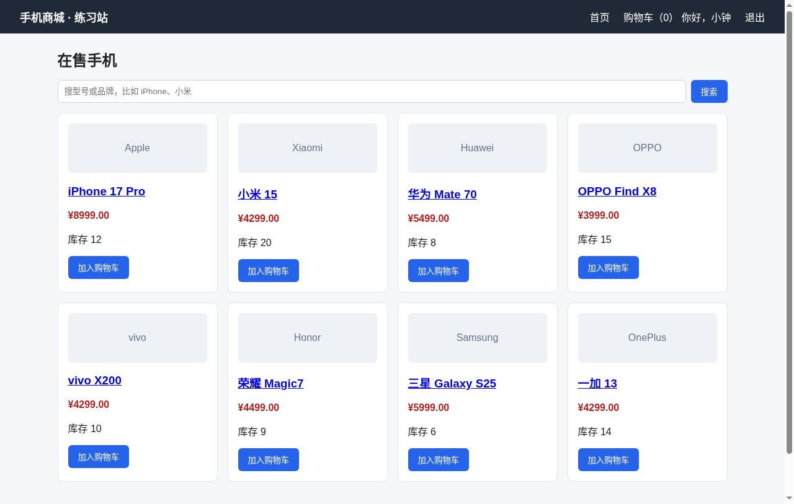
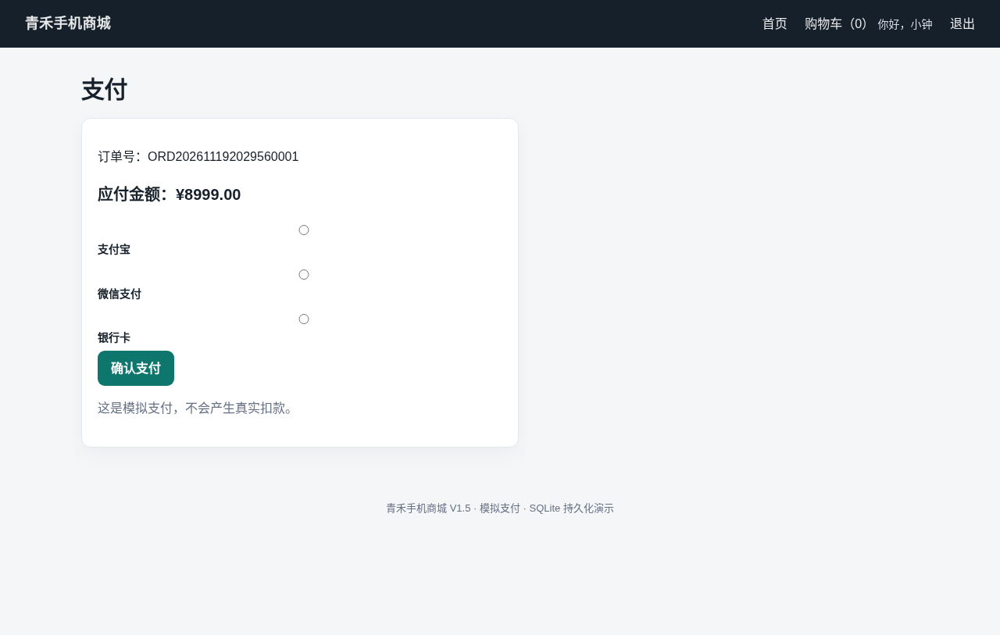

# 手机商城 UI 自动化测试


这是我在准备软件测试岗面试时做的一个练习项目。前端不是我重点，页面只是给 Selenium 提供真实的点击、输入和跳转；重点在页面对象封装、用例组织、数据驱动和失败排查。

被测站点是一个能跑通的手机商城：登录、搜索、商品详情、购物车、结算、订单、支付都有。测试代码在 `tests/`，页面对象在 `pages/`，站点在 `shop/`。

## 页面预览

| 首页 | 购物车 |
| --- | --- |
|  |  |

| 订单详情 | 支付页 |
| --- | --- |
|  |  |

## 测试范围

5 条主链路，45 条用例：

| 链路 | 用例数 | 覆盖点 |
| --- | ---: | --- |
| 登录 | 9 | 正常登录、密码错误、空值、停用账号、退出、邮箱大小写 |
| 搜索 | 7 | 精确型号、品牌、无结果、空关键词、大小写、详情跳转、库存展示 |
| 购物车 | 10 | 加购、同款累加、多商品、改数量、删除、空购物车、导航数量、去结算、库存上限 |
| 下单 | 9 | 未登录拦截、金额展示、提交成功、收货人、手机号、地址校验、金额一致、VIP 折扣 |
| 支付 | 10 | 金额、支付宝/微信/银行卡、未选方式、重复支付、库存扣减、金额不变、越权查看、未登录 |

## 技术栈

- Python 3.12、Selenium 4、pytest
- 页面对象模式（POM），页面操作和断言分开
- YAML 管理搜索数据，见 `data/search_cases.yaml`
- `pytest-rerunfailures` 失败重跑一次
- 失败自动截图，同时在 `pytest_runtest_makereport` 里挂到 Allure 附件
- Allure 结果目录：`reports/allure-results`

## 目录

```
shop/                被测站点（Flask），8 款手机、3 个账号
pages/               页面对象：登录、首页、详情、购物车、结算、订单、支付
tests/               5 个测试文件 + conftest
data/                YAML 测试数据
docs/                测试计划、用例设计、缺陷清单、执行报告、页面截图
pytest.ini           reruns、Allure 输出目录、smoke 标记
```

## 本地运行

```bash
pip install -r requirements.txt
python shop/app.py --port 9500
```

另开终端：

```bash
pytest
```

测试会自己在空闲端口拉起站点，不依赖手动开的 9500。浏览器默认找 `/usr/local/bin/chromium` 和 `/usr/local/bin/chromedriver`，也可以改环境变量：

```bash
CHROME_BIN=/usr/bin/google-chrome CHROMEDRIVER=/usr/bin/chromedriver pytest
```

只跑主链路冒烟：

```bash
pytest -m smoke
```

看 Allure 报告（本机要先装 Allure Commandline）：

```bash
allure serve reports/allure-results
```

## 测试账号

| 账号 | 密码 | 说明 |
| --- | --- | --- |
| student@example.com | Shop@123 | 普通用户 |
| vip@example.com | Vip@123 | 会员，95 折 |
| blocked@example.com | Block@123 | 停用账号 |

## 实测结果

最近一次全量执行（`pytest`，配置了失败重跑 1 次）：

```
43 passed, 2 xfailed, 1 rerun in 96.45s
```

45 条用例里，43 条通过，2 条是已知缺陷用 `xfail` 挂着，首轮 42 条通过，重跑 1 条后通过率 95.6%。最早一版首轮通过率只有 78%，问题集中在订单页渲染和页面跳转等待，这部分过程写在执行报告里。

具体记录在 [docs/04-测试执行报告.md](docs/04-测试执行报告.md)。

## 已知问题

`xfail` 不是写错断言，是两个站点本身的问题：

- **SHOP-01**：购物车不校验库存，库存 12 台时可以加 13 台，结算也不拦
- **SHOP-02**：登录邮箱区分大小写，`Student@example.com` 登不进去

复现步骤、期望和实际结果在 [docs/03-缺陷清单.md](docs/03-缺陷清单.md)。

## 说明

站点是练习用的，支付是模拟的，没有接真实支付和短信。接口和数据都放在内存里，重启就回到初始状态，方便测试反复跑。
