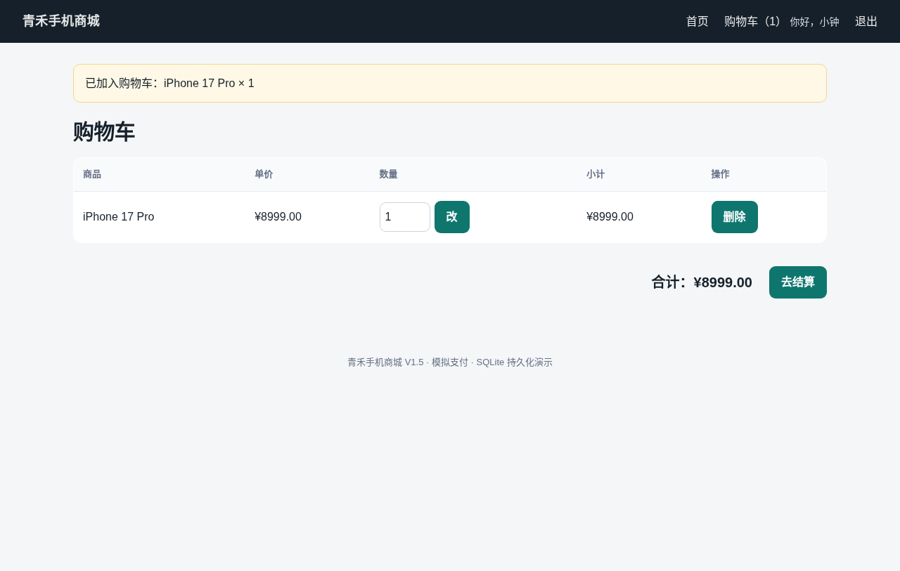

# 青禾手机商城 · Flask Web 应用（V1.5）


青禾手机商城是一个面向校园场景的手机商城 Web 应用。用户可以浏览手机、搜索品牌或型号、查看详情、加入购物车、填写收货信息、使用优惠券、下单并完成模拟支付；管理员可以在后台管理订单、库存、优惠券和账号。

项目在 V1 的基础上做增量升级，保留 Flask + Jinja2 服务端渲染和原有页面交互，不引入前端构建步骤，同时补齐数据库持久化、订单状态机、库存并发控制、安全校验和管理后台。

## V1.5 升级内容

| 维度 | V1 | V1.5 |
| --- | --- | --- |
| 数据存储 | 内存字典，重启丢失 | SQLite 持久化，自动建表与种子数据 |
| 订单状态 | 仅 `pending` / `paid` | `pending` / `paid` / `shipped` / `completed` / `cancelled` / `refunding` / `refunded`，并有状态流水 |
| 库存 | 支付后扣减，可超卖 | 下单事务内锁定库存，取消/退款释放，防止并发超卖 |
| 安全 | 明文密码、无 CSRF | PBKDF2 密码哈希、CSRF Token、登录限流、Session Cookie 安全属性、统一错误页 |
| 优惠 | 仅 VIP 95 折 | VIP 折扣 + 固定金额券 / 百分比券 + 门槛、次数、有效期校验 |
| 后台 | 无 | 订单发货/完成/退款、库存调整、优惠券创建、用户启停、数据看板 |
| 售后 | 无 | 待支付取消、已支付/已发货退款申请、管理员审核退款 |
| 测试 | 43 passed + 2 xfailed | 原有页面测试全部转正，并新增数据库、库存、状态机、优惠券、后台测试 |

## 页面

| 首页 | 购物车 |
| --- | --- |
|  |  |

| 订单详情 | 支付页 |
| --- | --- |
|  |  |

## 功能

### 用户端

- 首页：8 款手机卡片，展示品牌、价格、库存与低库存提示
- 搜索：按型号或品牌过滤，忽略大小写，支持空关键词
- 商品详情：价格、库存、描述、数量选择；库存不足时禁止加购
- 购物车：加购、同款累加、修改数量、删除，库存上限校验
- 结算：收货人、手机号、地址校验，VIP 自动 95 折
- 优惠券：`WELCOME10`、`SAVE5`、`VIP20`，支持门槛、封顶、使用次数与有效期
- 下单：生成订单号、锁定库存、保存商品快照、记录状态流水
- 支付：支付宝 / 微信 / 银行卡三种模拟方式；支付成功写入支付方式与时间
- 订单：订单详情、状态进度、取消、退款申请、确认收货
- 账号：登录、退出、停用账号拦截、订单归属校验、大小写不敏感邮箱

### 管理后台

- 数据看板：订单总数、成交金额、活跃用户、在售商品、待支付、退款审核
- 订单管理：按状态筛选，发货、完成、退款、取消
- 商品库存：实时调整库存，低库存高亮
- 优惠券：创建固定金额券或百分比券，设置门槛、封顶、次数
- 账号管理：启用/停用普通用户与 VIP 用户

## 技术栈

- Python 3.12
- Flask 3 + Jinja2 模板
- SQLite 3（Python 标准库 `sqlite3`，零额外服务）
- HTML + CSS，服务端渲染，没有前端构建步骤
- 金额以整数分存储，展示层统一格式化为两位小数
- `werkzeug.security` 做密码哈希与校验
- pytest + Selenium 做页面自测；pytest 测试客户端做业务规则测试

## 项目结构

```text
shop/
  app.py                 Flask 应用：路由、CSRF、登录、后台
  db.py                  SQLite 连接、建表、种子数据与重置
  services.py            商品、购物车、计价、订单状态机、优惠券
  schema.sql             数据库表结构与索引
  templates/             Jinja2 模板：商城页面 + 管理后台 + 错误页
  static/style.css       页面样式
tests/                   页面自测 + 业务规则测试
  pages/                 Selenium 页面对象
  data/                  搜索参数数据
docs/                    项目说明、系统设计、数据模型、路由、部署
docs/images/             页面截图
```

数据库文件默认生成在 `shop/data/shop.db`，已在 `.gitignore` 中排除；表结构由 `shop/schema.sql` 管理。

## 页面路由

| 方法 | 路径 | 说明 |
| --- | --- | --- |
| GET | `/` | 首页，`?q=` 搜索 |
| GET/POST | `/login` | 登录，支持 `next` 回跳 |
| GET | `/logout` | 退出并清空会话 |
| GET | `/search` | 搜索入口，跳转到首页 |
| GET | `/product/<pid>` | 商品详情 |
| GET | `/cart` | 购物车 |
| POST | `/cart/add/<pid>` | 加入购物车，校验库存 |
| POST | `/cart/update/<pid>` | 修改数量，校验库存 |
| POST | `/cart/remove/<pid>` | 删除商品 |
| GET/POST | `/checkout` | 结算并创建订单，库存不足会拦截 |
| POST | `/checkout/coupon` | 应用优惠券 |
| POST | `/checkout/coupon/clear` | 清除优惠券 |
| GET | `/order/<order_no>` | 订单详情，只能看自己的订单；管理员可查看 |
| POST | `/order/<order_no>/cancel` | 取消待支付订单并释放库存 |
| POST | `/order/<order_no>/refund` | 申请退款 |
| POST | `/order/<order_no>/complete` | 确认收货 |
| GET/POST | `/pay/<order_no>` | 模拟支付，只能支付自己的待支付订单 |
| GET | `/admin` | 管理后台，`?status=` 筛选订单 |
| POST | `/admin/orders/<order_no>/<action>` | 后台发货、完成、退款、取消 |
| POST | `/admin/products/<pid>/stock` | 调整商品库存 |
| POST | `/admin/coupons` | 创建优惠券 |
| POST | `/admin/users/<id>/toggle` | 启用/停用用户 |
| GET | `/api/health` | 健康检查 |
| GET | `/dev/reset` | 仅本机可用的演示数据重置 |

所有写操作表单都带 CSRF Token；`/dev/reset` 只允许 `127.0.0.1` / `::1` 访问。

## 订单状态

```text
pending（待支付）
  ├─ 支付 → paid（已支付）
  │    ├─ 发货 → shipped（已发货）
  │    │    └─ 确认收货 → completed（已完成）
  │    └─ 申请退款 → refunding（退款审核中）
  │         └─ 管理员同意 → refunded（已退款）
  └─ 取消 → cancelled（已取消）
```

库存策略：下单时在事务中扣减库存，`cancelled` / `refunded` 时按订单明细释放一次；`stock_restored` 字段防止重复释放。订单状态流水保存在 `order_status_logs`，用于审计和详情页时间线。

## 计价规则

```text
商品小计 = Σ（商品单价 × 数量）
VIP 优惠 = 小计 × 5%（VIP 用户）
优惠券优惠 = 固定金额，或（小计 - VIP 优惠）× 百分比，受封顶限制
应付金额 = max(0, 小计 - VIP 优惠 - 优惠券优惠)
```

- 商品价格以整数分保存，计算和入库不出现浮点数；
- 优惠券门槛按商品小计判断，不与 VIP 优惠后的金额混算；
- 优惠券一次性核销，记录在 `coupon_redemptions`；
- 模板只展示格式化后的金额字符串。

## 安全设计

- 密码：PBKDF2-SHA256 哈希存储，不保存明文；
- CSRF：Session 中保存随机 Token，所有 POST 表单校验；
- 登录限流：同一 IP + 邮箱 10 分钟内最多失败 10 次；
- Session：`HttpOnly`、`SameSite=Lax`，生产环境可通过 `SHOP_COOKIE_SECURE=1` 开启 Secure；
- 权限：用户只能查看/支付自己的订单；管理员后台独立校验 `role=admin`；
- 输入校验：数量、库存、金额、手机号、地址逐项校验；
- 演示接口：`/dev/reset` 只允许本机访问。

## 本地运行

```bash
pip install -r requirements.txt
python shop/app.py --port 9500
```

打开 `http://127.0.0.1:9500`。

健康检查：

```bash
curl http://127.0.0.1:9500/api/health
```

返回示例：

```json
{"orders":0,"products":8,"status":"up","version":"1.5"}
```

重置演示数据：

```bash
curl http://127.0.0.1:9500/dev/reset
```

会恢复 8 款手机的库存、清空订单与优惠券核销记录、清空当前会话。

环境变量：

| 变量 | 默认 | 说明 |
| --- | --- | --- |
| `SHOP_DB` | `shop/data/shop.db` | SQLite 数据库路径 |
| `SHOP_SECRET_KEY` | 开发默认值 | Flask Session 密钥，生产必须修改 |
| `SHOP_COOKIE_SECURE` | `0` | 设为 `1` 时 Cookie 仅走 HTTPS |
| `SHOP_DEMO` | `1` | 演示模式标记 |

## 演示账号

| 账号 | 密码 | 说明 |
| --- | --- | --- |
| student@example.com | Shop@123 | 普通用户 |
| vip@example.com | Vip@123 | 会员，95 折 |
| blocked@example.com | Block@123 | 停用账号，登录会被拦截 |
| admin@example.com | Admin@123 | 管理员，可进入 `/admin` |

## 自测

安装自测依赖：

```bash
pip install -r requirements-dev.txt
pytest
```

只跑业务规则测试（不启动浏览器）：

```bash
pytest tests/test_business.py
```

最近一次完整自测：`54 passed`。原来的两个 `xfail`（库存校验、邮箱大小写）已在 V1.5 修复并转为正式用例。

## 设计说明

- **服务端渲染**：页面用 Jinja2 直接渲染，不引入 React/Vue，减少部署步骤；
- **SQLite 持久化**：单文件数据库，适合课程演示、个人项目和轻量部署；生产可平滑替换为 MySQL/PostgreSQL；
- **下单锁库存**：在 `BEGIN IMMEDIATE` 事务中检查并扣减库存，避免并发下单超卖；
- **订单状态机**：集中定义允许的状态迁移，路由不直接改状态；
- **金额用整数分**：避免浮点误差，也方便后续对接支付渠道；
- **管理后台**：与商城共用登录态，通过角色校验隔离权限。

## 当前版本边界

- 支付是模拟流程，没有接真实支付渠道；
- SQLite 适合单机或轻量部署，生产多实例建议换 MySQL/PostgreSQL，并把 Session 换到 Redis；
- 没有做商品图片上传、SKU 规格、物流轨迹、发票和真实短信；
- 优惠券为平台券，未做领券中心和用户券包；
- 管理后台是运营演示版，未接入细粒度 RBAC 和审计日志导出。

## GitHub Actions

`.github/workflows/ui-tests.yml` 在每次 push / PR 时：

1. 安装 Python 依赖；
2. 使用 `browser-actions/setup-chrome` 安装 Chrome 与 ChromeDriver；
3. 启动 Flask 服务；
4. 执行全部 pytest 用例；
5. 上传 Allure 结果与失败截图。
