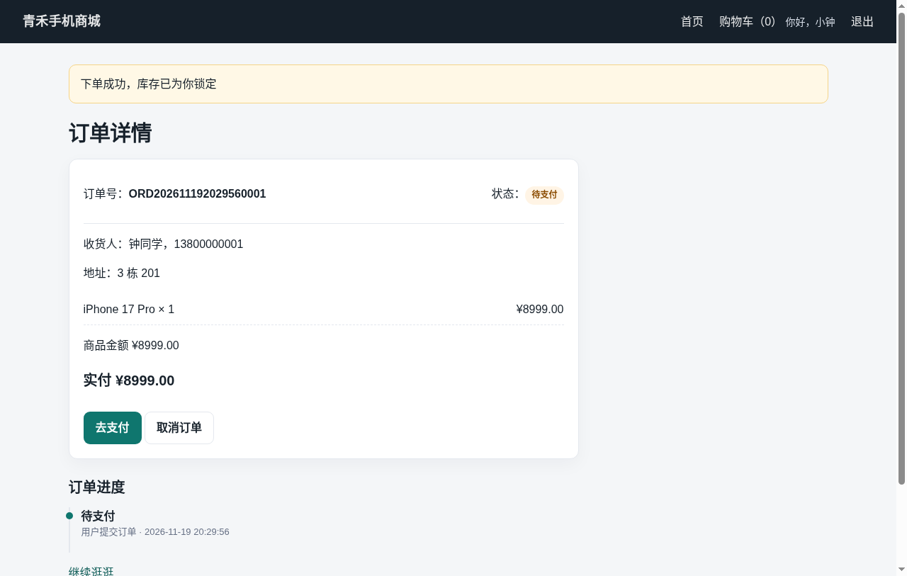

# 青禾手机商城 · Flask Web 应用


青禾手机商城是一个 Flask 写的手机商城 Web 应用：用户可以浏览手机、搜索品牌或型号、查看详情、加入购物车、填写收货信息、下单并选择支付方式。支付成功后订单状态变为已支付，商品库存同步扣减。

这个项目是我独立开发的，重点在页面交互、会话购物车、金额计算和订单状态流转。

## 页面

| 首页 | 购物车 |
| --- | --- |
|  |  |

| 订单详情 | 支付页 |
| --- | --- |
|  |  |

## 功能

- 首页：8 款手机卡片，展示品牌、价格、库存
- 搜索：按型号或品牌过滤，支持空关键词
- 商品详情：价格、库存、描述、数量选择
- 购物车：加购、同款累加、修改数量、删除、清空
- 结算：收货人、手机号、地址校验，VIP 自动 95 折
- 订单：生成订单号、记录商品明细、显示金额和状态
- 支付：支付宝 / 微信 / 银行卡三种模拟方式，支付后扣库存
- 账号：登录、退出、停用账号拦截、订单归属校验

## 技术栈

- Python 3.12
- Flask 3 + Jinja2 模板
- HTML + CSS，服务端渲染，没有前端构建步骤
- `Decimal` 做金额计算，避免浮点误差
- `session` 保存登录态和购物车
- pytest + Selenium 做页面自测

## 项目结构

```
shop/
  app.py                 Flask 应用：路由、业务逻辑、数据
  templates/             Jinja2 模板：首页、登录、详情、购物车、结算、订单、支付
  static/style.css       页面样式
tests/                   页面自测脚本
  pages/                 Selenium 页面对象
  data/                  搜索参数数据
docs/                    项目说明、系统设计、数据模型、路由、部署、自测
docs/images/             页面截图
```

## 页面路由

| 方法 | 路径 | 说明 |
| --- | --- | --- |
| GET | `/` | 首页，`?q=` 搜索 |
| GET/POST | `/login` | 登录 |
| GET | `/logout` | 退出并清空购物车 |
| GET | `/search` | 搜索入口，跳转到首页 |
| GET | `/product/<pid>` | 商品详情 |
| GET | `/cart` | 购物车 |
| POST | `/cart/add/<pid>` | 加入购物车 |
| POST | `/cart/update/<pid>` | 修改数量 |
| POST | `/cart/remove/<pid>` | 删除商品 |
| GET/POST | `/checkout` | 结算，登录后可用 |
| GET | `/order/<order_no>` | 订单详情，只能看自己的订单 |
| GET/POST | `/pay/<order_no>` | 支付，只能支付自己的订单 |
| GET | `/api/health` | 健康检查 |
| GET | `/dev/reset` | 本地开发重置商品、订单和会话 |

## 业务规则

### 金额

- 商品价格用字符串保存，计算时转 `Decimal`；
- 每行小计 = 单价 × 数量；
- 小计求和得到 `subtotal`；
- VIP 用户减 5%，折扣用 `Decimal("0.05")` 计算；
- 所有金额保留两位小数，四舍五入用 `ROUND_HALF_UP`；
- 模板里只展示格式化后的字符串，不参与再计算。

### 购物车

购物车存在 Flask `session` 里，结构是 `{商品 id: 数量}`：

```json
{"1": 2, "3": 1}
```

- 同一商品重复加购会累加数量；
- 修改数量为 0 或负数时删除该商品；
- 退出登录会清空购物车；
- 购物车数量在导航栏实时显示。

### 订单

订单号格式：

```
ORD + YYYYMMDDHHMMSS + 4 位序号
```

订单字段包括：

- `order_no`、`email`
- `lines`：商品名、单价、数量、小计、商品 id
- `subtotal`、`discount`、`total`
- `receiver`、`phone`、`address`
- `status`：`pending` / `paid`
- `payment_method`、`created_at`、`paid_at`

### 支付

- 支付前校验订单归属，别人的订单不能支付；
- 已支付订单再次进入支付页会提示，不会重复扣库存；
- 支付方式只接受 `alipay`、`wechat`、`card`；
- 支付成功后按订单明细扣减库存，库存最小为 0。

## 本地运行

```bash
pip install -r requirements.txt
python shop/app.py --port 9500
```

打开 `http://127.0.0.1:9500`。

健康检查：

```bash
curl http://127.0.0.1:9500/api/health
```

返回：

```json
{"orders":0,"products":8,"status":"up"}
```

重置演示数据：

```bash
curl http://127.0.0.1:9500/dev/reset
```

## 演示账号

| 账号 | 密码 | 说明 |
| --- | --- | --- |
| student@example.com | Shop@123 | 普通用户 |
| vip@example.com | Vip@123 | 会员，95 折 |
| blocked@example.com | Block@123 | 停用账号，登录会被拦截 |

## 设计说明

- **服务端渲染**：页面用 Jinja2 直接渲染，不引入 React/Vue，减少部署步骤；
- **session 购物车**：未登录也可以加购，登录后继续结算；购物车不落库，重启服务会清空；
- **金额用 Decimal**：所有价格、折扣、总价都用 `Decimal`，避免 `0.1 + 0.2` 的精度问题；
- **订单归属校验**：订单详情和支付都校验 `order["email"] == user["email"]`，防止越权查看或支付；
- **库存扣减**：支付成功后按订单行扣库存，重复支付直接拦截；
- **数据在内存**：商品、订单、用户都放在 `shop/app.py` 里，启动时重置，适合演示和本地开发。

## 当前版本边界

- 数据在内存，重启后订单和库存恢复初始值；
- 没有接数据库，商品和用户是代码里的种子数据；
- 支付是模拟流程，没有接真实支付渠道；
- 没有后台管理、优惠券、物流和退款；
- 没有 CSRF token、限流和密码哈希，生产环境需要补；
- 购物车不校验库存，库存不足也能加购，这是当前版本的已知边界。

## 自测

仓库带一套 Selenium 页面自测，覆盖登录、搜索、购物车、下单、支付 5 条链路：

```bash
pip install -r requirements-dev.txt
pytest
```

最近一次本地自测：`43 passed, 2 xfailed in 76.77s`。两条 `xfail` 对应上面“当前版本边界”里的库存校验和邮箱大小写规则，不是页面打不开。CI 会安装 Chrome 和 ChromeDriver 跑同一套用例。
