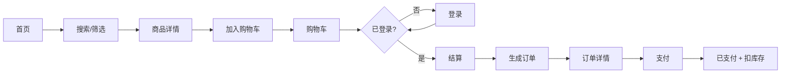

# 项目说明

## 背景

青禾手机商城是一个课程项目，目标是把一个手机电商网站的主要页面和下单流程做出来，而不是只做静态页面。

用户可以：

- 浏览在售手机，按品牌或型号搜索；
- 查看商品价格、库存和描述；
- 把商品加入购物车，改数量、删除；
- 登录后填写收货信息，提交订单；
- 选择支付方式，完成模拟支付；
- 查看自己的订单和支付状态。

管理员和真实支付不在这个版本里。

## 页面

| 页面 | 路径 | 说明 |
| --- | --- | --- |
| 首页 | `/` | 商品列表、搜索框、购物车数量 |
| 登录 | `/login` | 邮箱 + 密码 |
| 商品详情 | `/product/<id>` | 价格、库存、描述、数量选择 |
| 购物车 | `/cart` | 商品行、数量修改、删除、小计 |
| 结算 | `/checkout` | 收货人、手机号、地址、金额明细 |
| 订单 | `/order/<order_no>` | 订单明细、状态、支付入口 |
| 支付 | `/pay/<order_no>` | 支付宝 / 微信 / 银行卡 |

## 用户流程

## 账号

| 账号 | 密码 | 说明 |
| --- | --- | --- |
| `student@example.com` | `Shop@123` | 普通用户 |
| `vip@example.com` | `Vip@123` | 会员，结算自动 95 折 |
| `blocked@example.com` | `Block@123` | 停用账号，登录被拦截 |

账号数据在 `shop/app.py` 的 `USERS` 字典里，当前版本没有注册和数据库。

## 商品

首页固定 8 款手机：

| 商品 | 品牌 | 价格 | 初始库存 |
| --- | --- | ---: | ---: |
| iPhone 17 Pro | Apple | 8999.00 | 12 |
| 小米 15 | Xiaomi | 4299.00 | 20 |
| 华为 Mate 70 | Huawei | 5499.00 | 8 |
| OPPO Find X8 | OPPO | 3999.00 | 15 |
| vivo X200 | vivo | 4299.00 | 10 |
| 荣耀 Magic7 | Honor | 4499.00 | 9 |
| 三星 Galaxy S25 | Samsung | 5999.00 | 6 |
| 一加 13 | OnePlus | 4299.00 | 14 |

商品字段：`id`、`name`、`brand`、`price`、`stock`、`desc`。

## 业务规则

### 搜索

- 关键词同时匹配商品名和品牌，忽略大小写；
- 空关键词返回全部商品；
- 没有匹配时显示“没有找到相关商品”。

### 购物车

- 未登录也可以加购，购物车存在 session；
- 同一商品重复加购累加数量；
- 数量改为 0 或负数时删除；
- 退出登录清空购物车；
- 导航栏显示购物车总数量。

### 结算

- 必须登录；
- 购物车为空不能结算；
- 收货人至少 2 个字；
- 手机号必须是 11 位、`1[3-9]` 开头；
- 地址至少 5 个字；
- VIP 用户自动减 5%，普通用户无折扣。

### 订单

- 订单号：`ORD` + 年月日时分秒 + 4 位序号；
- 订单保存商品快照，不直接引用商品对象；
- 下单后清空购物车；
- 订单状态只有 `pending` 和 `paid`。

### 支付

- 只能支付自己的订单；
- 已支付订单再次进入支付页会提示，不会重复扣库存；
- 支付方式只允许 `alipay`、`wechat`、`card`；
- 支付成功后按订单行扣库存，库存不小于 0。

## 项目边界

这个版本是课程演示，数据在内存，重启后恢复初始值。没有做：

- 数据库持久化；
- 用户注册、后台管理；
- 真实支付、退款、物流；
- 优惠券、秒杀、推荐；
- CSRF、限流、密码哈希。

这些在 README 的“当前版本边界”里也列了一遍。
