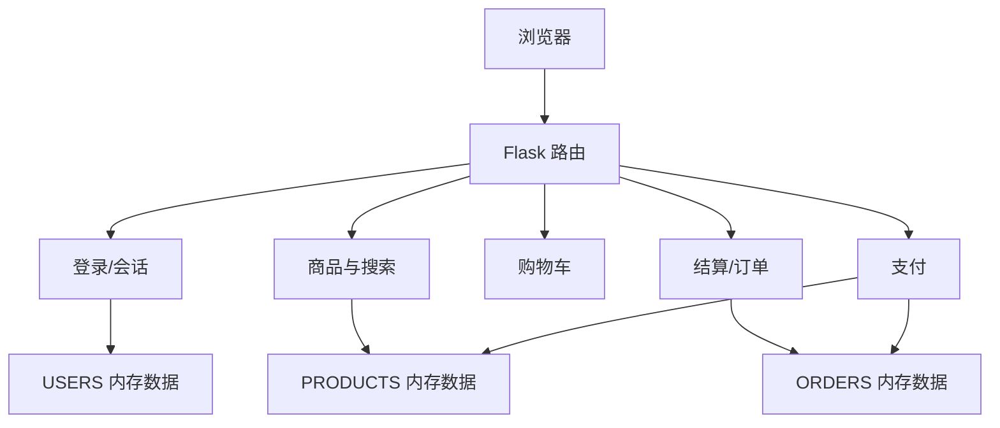

# 系统设计

## 总体结构

应用是单文件 Flask 服务 `shop/app.py`，模板在 `shop/templates`，样式在 `shop/static/style.css`。



### 模块

| 模块 | 代码 | 职责 |
| --- | --- | --- |
| 应用入口 | `shop/app.py` | 创建 Flask 应用、注册路由 |
| 商品 | `PRODUCTS_SEED` / `PRODUCTS` | 商品种子数据和运行时库存 |
| 用户 | `USERS` | 演示账号、会员等级、启用状态 |
| 购物车 | `cart_items()` / session | 读取 session 购物车，算小计 |
| 结算 | `checkout()` | 收货信息校验、折扣、生成订单 |
| 订单 | `ORDERS` / `get_order()` | 订单列表、订单详情、归属校验 |
| 支付 | `pay()` | 支付方式校验、状态更新、扣库存 |
| 模板 | `shop/templates/*.html` | 页面渲染 |
| 样式 | `shop/static/style.css` | 页面布局和颜色 |

## 请求处理

以“提交订单”为例：

1. 浏览器 `POST /checkout`，表单带收货人、手机号、地址；
2. `current_user()` 从 session 取邮箱，未登录跳转登录页；
3. `cart_items()` 读购物车，空购物车跳回购物车；
4. 校验收货人、手机号、地址，有错误用 `flash` 提示并重新渲染结算页；
5. `discount_for()` 计算 VIP 折扣；
6. 生成订单号，把商品名、单价、数量、小计写进 `order["lines"]`；
7. `ORDERS.append(order)`，清空 session 购物车；
8. 重定向到订单详情页。

## 会话

Flask `session` 保存两类数据：

```python
session["email"] = "student@example.com"
session["cart"] = {"1": 2, "3": 1}
```

- 登录成功写入 `email`；
- 退出时删除 `email` 和 `cart`；
- 购物车 key 是字符串商品 id，value 是数量；
- session 用 Flask 默认的签名 cookie，密钥在 `app.secret_key`。

当前版本没有把购物车落库，换浏览器或清 cookie 后购物车会丢。

## 金额计算

金额不在模板里算，全部在 Python 里用 `Decimal`：

```python
line = Decimal(p["price"]) * qty
subtotal += line
discount = (subtotal * Decimal("0.05")).quantize(Decimal("0.01"), rounding=ROUND_HALF_UP)
total = subtotal - discount
```

- 商品价格是字符串，避免二进制浮点；
- 每行小计和总价保留两位小数；
- 模板只接收 `money()` 格式化后的字符串；
- 支付金额直接用订单里的 `total`，不会重新计算。

## 订单模型

订单是字典：

```python
{
    "order_no": "ORD202611191030001234",
    "email": "student@example.com",
    "lines": [
        {"name": "iPhone 17 Pro", "price": "8999.00", "qty": 1,
         "line_total": "8999.00", "pid": 1}
    ],
    "subtotal": "8999.00",
    "discount": "449.95",
    "total": "8549.05",
    "receiver": "钟同学",
    "phone": "13800000001",
    "address": "江西省南昌市XX路XX号",
    "status": "pending",
    "payment_method": None,
    "created_at": "2026-11-19 10:30:00",
    "paid_at": None
}
```

- `lines` 是下单时的商品快照，商品后来改价不影响订单；
- `status` 只有 `pending` / `paid`；
- 支付后写 `payment_method`、`paid_at`，并按 `pid` 扣库存。

## 权限

| 页面 | 校验 |
| --- | --- |
| `/checkout` | 必须登录 |
| `/order/<order_no>` | 登录 + 订单邮箱等于当前用户 |
| `/pay/<order_no>` | 登录 + 订单邮箱等于当前用户 + 未支付 |

订单详情和支付都做了归属校验，避免登录用户查看或支付别人的订单。

## 模板

- `base.html`：导航、购物车数量、登录状态、footer；
- `index.html`：商品卡片、搜索框、无结果提示；
- `login.html`：登录表单、演示账号提示；
- `product.html`：商品信息、数量选择、加购；
- `cart.html`：商品行、数量修改、删除、结算按钮；
- `checkout.html`：收货表单、金额明细；
- `order.html`：订单信息、商品明细、支付入口；
- `pay.html`：支付方式选择、订单金额。

页面使用 Jinja2 继承，`base.html` 提供 `cart_count()` 和 `current_user()` 两个全局函数。

## 错误处理

- 商品不存在：返回 404；
- 订单不存在：返回 404；
- 越权查看/支付：返回 403；
- 表单校验失败：`flash` 错误并重新渲染页面；
- 未登录访问结算/订单/支付：重定向登录页。

没有统一异常页，生产环境应该补 404/500 模板和日志。

## 部署

当前用 Flask 自带开发服务器：

```bash
python shop/app.py --port 9500
```

生产环境应该用 Gunicorn：

```bash
gunicorn -w 2 -b 0.0.0.0:9500 'shop.app:app'
```

需要注意：现在订单和库存都在进程内存里，多 worker 会各存一份，必须先落库才能多进程部署。
