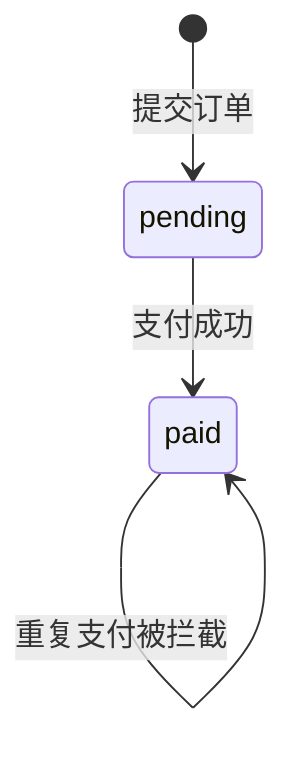

# 数据模型

当前版本所有数据都在内存里，代码在 `shop/app.py`。这一页说明各个结构的字段、类型和关系，方便后续换成数据库。

## 商品 Product

```python
{
    "id": 1,
    "name": "iPhone 17 Pro",
    "brand": "Apple",
    "price": "8999.00",
    "stock": 12,
    "desc": "A19 Pro 芯片，6.3 英寸屏幕，256GB。"
}
```

| 字段 | 类型 | 说明 |
| --- | --- | --- |
| `id` | int | 商品 id，路由里用 |
| `name` | string | 商品名 |
| `brand` | string | 品牌，搜索会匹配 |
| `price` | string | 价格，字符串保存，计算时转 Decimal |
| `stock` | int | 库存，支付后扣减 |
| `desc` | string | 商品描述 |

商品在 `PRODUCTS_SEED` 里定义，启动时复制到 `PRODUCTS`。`reset_data()` 会恢复初始库存。

## 用户 User

```python
{
    "password": "Shop@123",
    "name": "小钟",
    "level": "normal",
    "active": True
}
```

| 字段 | 类型 | 说明 |
| --- | --- | --- |
| `password` | string | 密码（当前版本明文） |
| `name` | string | 显示名 |
| `level` | string | `normal` / `vip` |
| `active` | bool | 是否启用，停用账号不能登录 |

`USERS` 的 key 是邮箱。当前版本没有注册接口。

## 购物车 Cart

存在 Flask session 里：

```python
session["cart"] = {
    "1": 2,
    "3": 1
}
```

- key 是商品 id 的字符串；
- value 是数量；
- 只保存 id 和数量，价格每次从 `PRODUCTS` 读，避免商品改价后购物车金额不一致。

`cart_items()` 会把 session 购物车转成：

```python
[
    {"product": {...}, "qty": 2, "line_total": "17998.00"}
]
```

同时返回 `subtotal`。

## 订单 Order

```python
{
    "order_no": "ORD202611191030001234",
    "email": "student@example.com",
    "lines": [
        {
            "name": "iPhone 17 Pro",
            "price": "8999.00",
            "qty": 1,
            "line_total": "8999.00",
            "pid": 1
        }
    ],
    "subtotal": "8999.00",
    "discount": "449.95",
    "total": "8549.05",
    "receiver": "钟同学",
    "phone": "13800000001",
    "address": "江西省南昌市XX路XX号",
    "status": "pending",
    "payment_method": None,
    "created_at": "2026-11-19 10:30:00",
    "paid_at": None
}
```

| 字段 | 类型 | 说明 |
| --- | --- | --- |
| `order_no` | string | 订单号，唯一 |
| `email` | string | 下单用户 |
| `lines` | list | 商品快照 |
| `subtotal` | string | 折扣前金额 |
| `discount` | string | 折扣金额 |
| `total` | string | 实付金额 |
| `receiver` | string | 收货人 |
| `phone` | string | 收货手机号 |
| `address` | string | 收货地址 |
| `status` | string | `pending` / `paid` |
| `payment_method` | string/null | `alipay` / `wechat` / `card` |
| `created_at` | string | 创建时间 |
| `paid_at` | string/null | 支付时间 |

订单行 `lines` 是下单时的快照，包含 `pid` 用来支付后扣库存。

## 订单状态



当前没有取消、退款、发货和完成状态。

## 如果换成 MySQL

可以把上面的结构落成 4 张表：

```sql
CREATE TABLE products (
  id INT PRIMARY KEY AUTO_INCREMENT,
  name VARCHAR(80) NOT NULL,
  brand VARCHAR(40) NOT NULL,
  price_cents INT NOT NULL,
  stock INT NOT NULL,
  description VARCHAR(255)
);

CREATE TABLE users (
  id INT PRIMARY KEY AUTO_INCREMENT,
  email VARCHAR(120) UNIQUE NOT NULL,
  password_hash VARCHAR(255) NOT NULL,
  name VARCHAR(40),
  level VARCHAR(16) NOT NULL DEFAULT 'normal',
  active TINYINT NOT NULL DEFAULT 1
);

CREATE TABLE orders (
  id INT PRIMARY KEY AUTO_INCREMENT,
  order_no VARCHAR(32) UNIQUE NOT NULL,
  user_id INT NOT NULL,
  subtotal_cents INT NOT NULL,
  discount_cents INT NOT NULL,
  total_cents INT NOT NULL,
  receiver VARCHAR(40) NOT NULL,
  phone VARCHAR(11) NOT NULL,
  address VARCHAR(120) NOT NULL,
  status VARCHAR(16) NOT NULL,
  payment_method VARCHAR(16),
  created_at DATETIME NOT NULL,
  paid_at DATETIME
);

CREATE TABLE order_items (
  id INT PRIMARY KEY AUTO_INCREMENT,
  order_id INT NOT NULL,
  product_id INT NOT NULL,
  product_name VARCHAR(80) NOT NULL,
  price_cents INT NOT NULL,
  qty INT NOT NULL
);
```

金额落库时同样用整数分，支付时在事务里扣库存和改订单状态，避免超卖。
